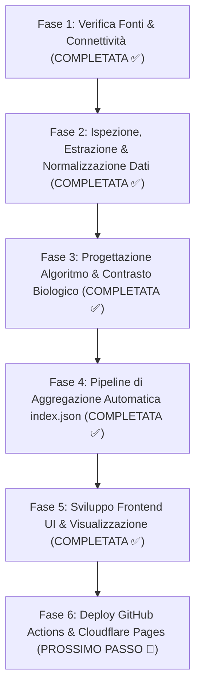

# Roadmap di Sviluppo – Extinction Risk Watch (Doomsday Tracker)

Roadmap operativa per lo sviluppo end-to-end del progetto: dall'acquisizione e conversione dei dati delle fonti target, alla definizione dell'algoritmo di stima della probabilità di estinzione (1, 10, 100 anni), fino alla realizzazione della dashboard web con orologio, grafici interattivi e feed notizie per argomento.

---

## Panoramica dello Stato di Avanzamento



---

## 🎯 Fase 1: Verifica Fonti & Connettività [COMPLETATA ✅]
* **Obiettivo**: Mappare tutte le fonti dati mondiali rilevanti e validare che siano accessibili e automatizzabili via HTTP request senza blocchi.
* **Risultati ottenuti**:
  * Catalogo machine-readable `sources.json` con 20 sorgenti categorizzate.
  * Documentazione completa `FONTI_TARGET.md`.
  * Motore di verifica multi-thread `src/verifier.py` e CLI `verify_sources.py`.
  * Test superato con il 100% di successo operativo sui 15 endpoint liberi di Livello A.

---

## 🔬 Fase 2: Ispezione Struttura Dati & Conversione [PROSSIMO PASSO 🚀]
* **Obiettivo**: Esaminare in profondità il payload grezzo di ogni fonte e costruire i moduli di estrazione (parser) che trasformano i dati in due canali distinti:
  1. **Canale Numerico (Serie Temporali per Grafici e Algoritmo)**
  2. **Canale Testuale (Notizie ed Emergenze per il Feed della UI)**

### 2.1 Sottocanale Numerico (Serie Storiche e Indicatori)
Per ciascuna fonte numerica, definiamo il parser dedicato e lo storico di riferimento:
* **Clima**:
  * $CO_2$ Mauna Loa (`noaa_co2_mlo`): estrazione valore giornaliero ppm, delta annuale e storico trentennale.
  * Ghiacci Artici (`nsidc_arctic_ice`): estrazione estensione giornaliera ($10^6\text{ km}^2$), anomalia rispetto al 1981-2010.
* **Fragilità Finanziaria**:
  * Indice CBOE VIX (`cboe_vix_history` / `yahoo_finance_vix`): estrazione chiusura giornaliera e calcolo percentile su 5 anni.
* **Guerra & Geopolitica**:
  * Indice GPR Caldara-Iacoviello (`gpr_iacoviello_daily`): estrazione del sub-indice $GPRT$ (minacce geopolitiche/nucleari).
* **Rischi Cosmici**:
  * Tempeste Solari NOAA (`noaa_swpc_kp`): estrazione picco $K_p$ nelle ultime 24-48 ore.
  * Asteroidi NASA Sentry (`nasa_sentry`): estrazione probabilistica aggregata e oggetti con Palermo Scale > -2.
  * Terremoti USGS (`usgs_earthquakes`): conteggio eventi sismici planetari $M \ge 6.0$.
* **Intelligenza Artificiale**:
  * Epoch AI (`epoch_ai_notable`): estrazione del compute massimo d'addestramento ($\text{FLOPs}$) e modelli di frontiera rilasciati nell'ultimo trimestre.

### 2.2 Sottocanale Testuale & Feed Notizie per la UI
Per alimentare la sezione notizie del sito divisa per argomento:
* **Pandemie**: titoli e dettagli da WHO DON API e feed RSS CIDRAP, con data, patogeno e paese.
* **Geopolitica & Conflitti**: eventi e notizie ad alto impatto nucleare/bellico estratti da GDELT.
* **Mercati di Previsione**: domande attive e probabilità correnti da Polymarket e Manifold Markets.
* **Arricchimento Semantico (Opzionale/Fase Avanzata)**: categorizzazione e assegnazione di un livello di gravità (1-5) tramite modello LLM leggero.

### Deliverable della Fase 2:
* Pacchetto `src/parsers/` con connettori specializzati per ciascuna fonte.
* Test unitari per validare l'estrazione corretta di numeri e notizie.
* Schema unificato del dato intermedio pulito (`RawExtractedData`).

---

## 🧮 Fase 3: Progettazione Algoritmo & Modello Matematico
* **Obiettivo**: Definire la formula trasparente che combina le baseline strutturali e i modulatori giornalieri per calcolare le probabilità di estinzione a 1, 10 e 100 anni.

### 3.1 Architettura dell'Algoritmo
1. **Probabilità di Base ($P_{\text{base}}$)**:
   * Basata sulla letteratura accademica (*The Precipice* di Toby Ord).
   * Ripartita per macrocategoria sui 100 anni (es. IA non allineata $10\%$, Pandemie ingegnerizzate $3.3\%$, Guerra nucleare $0.1\%$, ecc.).
2. **Declinazione Temporale**:
   * Orizzonte 100 anni: $P_{100} = 1 - \prod (1 - P_{i,100})$.
   * Orizzonte 10 anni e 1 anno: proiezione non lineare che tiene conto della concentrazione temporale (l'IA e le pandemie aumentano rapidamente nei prossimi decenni, mentre i rischi cosmici sono uniformi).
3. **Modulatore Dinamico Giornaliero ($M_i$)**:
   * Trasformazione a **percentile storico ($0.0 \dots 1.0$)** per ogni metrica numerica (es. un VIX a 40 corrisponde al $98^\circ$ percentile).
   * Range di modulazione controllato: ad esempio $\pm 30\%$ o $\pm 50\%$ rispetto alla baseline per evitare oscillazioni caotiche.
4. **Moltiplicatore di Fragilità Sistemica ($S$)**:
   * Indice di stress finanziario/globale come moltiplicatore di vulnerabilità: se il mondo è in grave crisi economica/istituzionale, l'impatto di un focolaio o di una tensione geopolitica è amplificato.

### Deliverable della Fase 3:
* Modulo `src/engine/calculator.py` documentato con formule matematiche matematicamente fondate e testate con simulazioni di casi limite (es. crisi stile Cuba 1962, pandemia stile 2020, crollo borse stile 2008).
* Documento esplicativo `METODOLOGIA_ALGORITMO.md` per garantire massima trasparenza pubblica.

---

## ⚙️ Fase 4: Pipeline di Aggregazione & Generazione `index.json`
* **Obiettivo**: Creare lo script orchestratore che gira periodicamente (giornalmente o a ogni ora per i dati veloci) e produce un unico file JSON statico compatto pronto per il frontend.

### Struttura del file `index.json`:
```json
{
  "last_updated": "2026-10-14T12:00:00Z",
  "extinction_clock": {
    "1_year": { "probability": 0.00018, "delta_yesterday": "+0.00001", "risk_level": "LOW" },
    "10_years": { "probability": 0.0245, "delta_yesterday": "+0.0003", "risk_level": "MODERATE" },
    "100_years": { "probability": 0.1740, "delta_yesterday": "+0.0012", "risk_level": "HIGH" }
  },
  "categories": {
    "nuclear_war": { "score": 0.42, "baseline": 0.001, "trend": "UP" },
    "ai_risk": { "score": 0.65, "baseline": 0.100, "trend": "UP" },
    "pandemics": { "score": 0.31, "baseline": 0.033, "trend": "STABLE" },
    "climate": { "score": 0.58, "baseline": 0.001, "trend": "UP" },
    "cosmic": { "score": 0.05, "baseline": 0.0001, "trend": "STABLE" }
  },
  "charts_data": {
    "vix_history": [...],
    "co2_trend": [...],
    "arctic_ice_extent": [...],
    "gpr_history": [...]
  },
  "news_feed": {
    "pandemics": [...],
    "geopolitics": [...],
    "ai": [...],
    "cosmic": [...]
  }
}
```

---

## 🎨 Fase 5: Sviluppo Frontend UI & Visualizzazione Dati
* **Obiettivo**: Costruire l'interfaccia web moderna, consultabile da desktop e mobile, minimalista e a forte impatto emotivo/politico per sensibilizzare il pubblico.

### Componenti Chiave della UI:
1. **L'Orologio dell'Estinzione (Hero Section)**:
   * Grande indicatore visivo (orologio / termometro / gauge) con le 3 probabilità (1 anno, 10 anni, 100 anni).
   * Confronto visivo con il Doomsday Clock (es. "Equivalente a 82 secondi dalla mezzanotte").
   * Delta rispetto al giorno precedente e direzione del trend.
2. **Dashboard dei Grafici per Macrocategoria**:
   * Grafici interattivi (es. Chart.js o Recharts) per $CO_2$, ghiacci artici, VIX, GPR index e avanzamento compute IA.
   * Visualizzazione dei percentili storici.
3. **Feed Notizie Tematico**:
   * Feed organizzato a tab/filtri per argomento (Pandemie, Guerra Nucleare, Clima, IA, Rischi Cosmici).
   * Badge di urgenza/rilevanza e link diretto alle fonti primarie.
4. **Sezione "Metodologia & Trasparenza"**:
   * Spiegazione della formula, citazione di Toby Ord e lista di tutte le fonti con indicatore di "freschezza del dato" (es. "Aggiornato 12 minuti fa").

---

## 🚀 Fase 6: Deploy, Automazione CI/CD & Manutenzione
* **Obiettivo**: Rendere il sito completamente autonomo a costo zero di gestione.
* **Architettura**:
  * **GitHub Actions**: workflow cron giornaliero (es. alle 06:00 UTC) e orario per i dati realtime.
  * **Hosting Statico**: Cloudflare Pages o GitHub Pages (velocità massima, sicurezza totale, nessun server vulnerabile).
  * **Fallback & Cache**: se una fonte è temporaneamente down, il sistema mantiene l'ultimo dato valido senza bloccare la generazione del sito.

---

## Tabella di Marcia Consigliata

| Fase | Descrizione | Stato | Output Principale |
| :---: | :--- | :---: | :--- |
| **1** | Verifica Fonti & Connettività | **Completata** | `sources.json`, `verify_sources.py` |
| **2** | Ispezione Struttura Dati & Parser | **In Avvio** | Parser Python per numeri e notizie |
| **3** | Algoritmo di Calcolo Indice | Prossima | `src/engine/calculator.py` |
| **4** | Pipeline di Generazione `index.json` | Pianificata | Cron job e aggregatore JSON statico |
| **5** | Frontend Web (Orologio, Grafici, News) | Pianificata | UI interattiva (HTML/CSS/JS o React) |
| **6** | Deploy su Cloudflare/GitHub Pages | Finale | Sito live in produzione |
